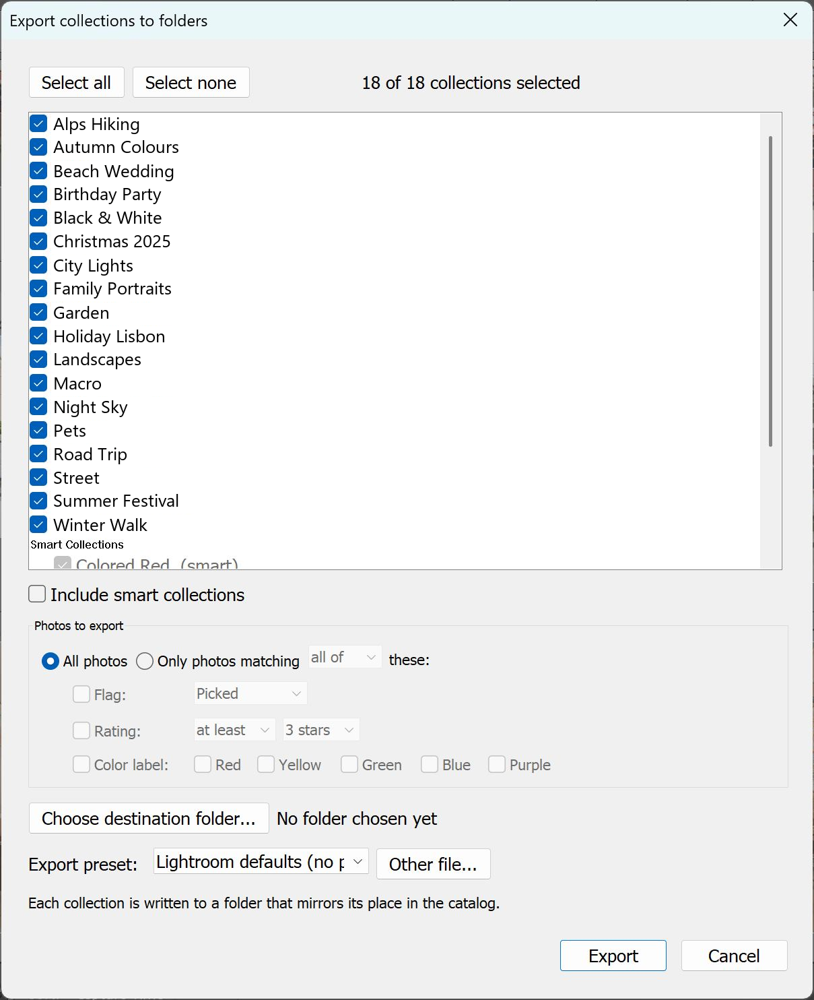

# Collections2Folders

> **This is a maintained fork.** The original by [amda](https://github.com/amda-phd)
> has had no commits since April 2024. This fork is version 2.0, which rewrote
> the interface and fixed the bugs that stopped the original from working on
> current Lightroom Classic releases. Issues and pull requests here are welcome.

The plugin exports collections to disk as a folder tree that mirrors your
catalog's collection hierarchy.

Lightroom Classic can export the photos in a collection, or multiple
collections into a single folder only. It cannot reproduce your collection
set structure as folders. This plugin does exactly that: tick the collections
you want, choose a destination and an export preset, and every collection
lands in its own folder nested exactly the way it is nested in the catalog.

## Requirements

Adobe Lightroom Classic 13 or newer. Tested only on Lightroom Classic
**15.5.1 [ 202608131348-cab7eed5 ]** on Windows 11. Other versions are expected
to work but have not been verified, and macOS is untested.

No warranty of any kind. Export to a scratch folder and confirm the result
before pointing it at anything you care about.

## Installation

1. Download or clone this repository. The folder must be named
   `Collections2Folders.lrdevplugin`, and it must live somewhere permanent —
   Lightroom stores the absolute path, so a folder you later move or delete
   will break the plugin.
2. In Lightroom Classic, open **File > Plug-in Manager**.
3. Click **Add**, select the `Collections2Folders.lrdevplugin` folder, and
   confirm that it reports as installed and running.

If you move the folder afterwards, remove the old entry in the Plug-in Manager
and add it again from the new location.

## Usage

Choose **File > Plug-in Extras > Export collections to folders**. Reading the
catalog takes a moment on large catalogs, then a single dialog opens.

1. **Pick your collections.** Every collection in the catalog is listed,
   indented under its collection sets. Everything starts checked; use **Select
   none** and tick what you want, or leave it to export the lot.
2. **Choose a destination folder.** This is the root the folder tree is built
   under. Required.
3. **Choose an export preset.** Your saved Lightroom presets appear in the
   dropdown, or leave it on **Lightroom defaults**.
4. **Click Export.** A cancellable progress dialog names each collection as it
   goes, and a summary reports what was written.

Given a catalog where `Tokyo` and `Kyoto` sit inside the set `Travel > Japan
2024`, exporting to `D:\Export` produces `D:\Export\Travel\Japan 2024\Tokyo\`
and `D:\Export\Travel\Japan 2024\Kyoto\`. Empty collections are skipped.

## Documentation

Full details — preset handling, folder naming rules, known limitations,
troubleshooting, and notes for developers — are in
[docs/technical.md](docs/technical.md).

## Credits and licence

Originally written by [amda](https://github.com/amda-phd) at
[amda-phd/Collections2Folders.lrdevplugin](https://github.com/amda-phd/Collections2Folders.lrdevplugin).
This is a fork; see the [changelog](docs/technical.md#changelog) for what
version 2.0 changed.

The upstream repository carries no licence file, which means the original author
retains all rights. Forking it on GitHub is permitted under GitHub's terms of
service, but redistributing it elsewhere is not, unless the author adds a
licence.
